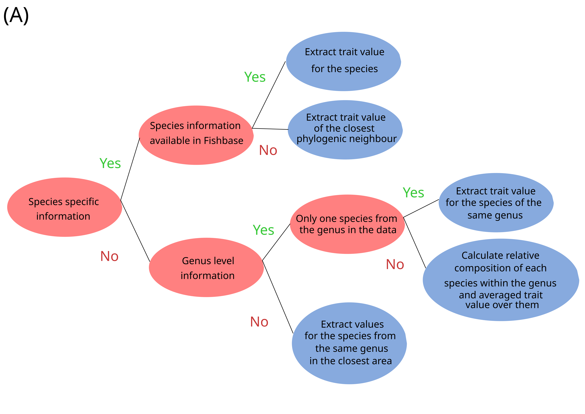
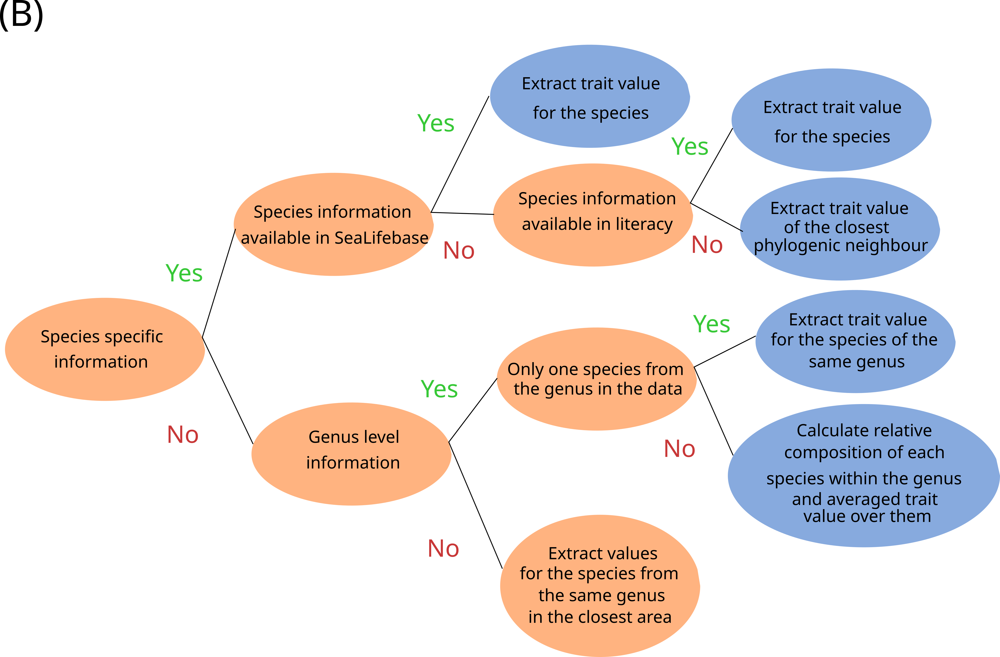

The data and analysis are presented in this document following the Material and Methods sections from the paper. 

```{r, results = "hide", warning = FALSE, message = FALSE}
library(FD)
library(ggplot2)
library(sf)
library(raster)
library(readr)
library(mecofun)
library(geodist)
library(spatialRF)
```


# 2.1. Ecological traits data

The trait database corresponds for fish and cephelopods to the traits by species extracted from Aquamaps for habitat traits and Fishbase and Sealifebase and papers for cephalopods (see paper for the detailed list of references). 
They include traits that were available for more than 75% of the species included in the analysis. 
When one trait was only missing for less than 25% of the species, the value was estimated based on these decision trees, for fish (A); for cephalopods (B). 
```{r,  echo=FALSE, fig.cap="A caption", out.width = '100%'}

```
```{r, echo=FALSE, fig.cap="A caption", out.width = '100%'}

```

Open the correpsonding database 
```{r}
BDT_FISH <- read.csv("DATA/BDT_FISH.csv")
BDT_CEPH<- read.csv("DATA/BDT_CEPHALO.csv")
```


Correlation matrix for the selected traits 
```{r}
panel.cor.m <- function(x, y, digits=2)
{
  usrold <- par()$usr; on.exit(par("usr"=usrold))
  par("usr" = c(0, 1, 0, 1))
  r <- cor(x, y,method = "spearman", use = "complete.obs")
  r2 <- abs(cor(x, y,method = "spearman", use = "complete.obs"))
  txt <- format(c(r, 0.123456789), digits=digits)[1]
  cex <- 0.8/strwidth(txt)
  text(0.5, 0.5, txt, cex = cex * r2)
  
}


pairs(BDT_FISH[,2:ncol(BDT_FISH)], lower.panel=panel.smooth, 
      upper.panel=panel.cor.m)


pairs(BDT_CEPH[,2:ncol(BDT_CEPH)], lower.panel=panel.smooth, 
      upper.panel=panel.cor.m)

```

# 2.2  Species abundance data 

```{r}
load("DATA/abundance_station_species_year_fish.Rdata")
fish_abundance<-stock_list_abundance
load("DATA/abundance_station_species_year_ceph.Rdata")
ceph_abundance<-stock_list_abundance
```

# 2.3 Environmental data 

With environmental variables followed by a x being the annual estimates and environmental variables followed by a y being the 'short term'/'immediate snapshot' of the environmental variables at the time of the sampling (november-december)

```{r}
 load("DATA/dataframe_model_2.Rdata")
```


# 2.4. Analysis


## 2.4.1. Ecological traits Community Weighted Means (CWMs)


Calculate CWM for fish 
```{r, results = "hide", warning = FALSE, message = FALSE}

# keep only selected traits and homogenized species names
keepTraits <- c("Mean_temperature","Max_depth","Range_salinity","Maximum_body_length","Growth_rate","Fecundity","Offspring_size","Age_maturity","Trophic_level_")
BDT_FISH$SPECIES<-gsub("_", ".", BDT_FISH$SPECIES)
rownames(BDT_FISH)<-BDT_FISH$SPECIES
trait<-BDT_FISH
trait <- trait[,keepTraits]
abu<-vector("list", length=24)
fishFD<-vector("list", length=24)

# create empty vector for all traits we are interested in 
Mean_temperature1<-Max_Depth1<-Maximum_body_length1<-Fecundity1<-Offspring_size1<-Trophic_level_1<-station1<-years1<-years2<-Range_salinity1<-Growth_rate1<-Age_maturity1<-NULL
Mean_temperature<-Max_Depth<-Maximum_body_length<-Fecundity<-Offspring_size<-Trophic_level_<-stations<-Range_salinity<-Growth_rate<-Age_maturity<-NULL

# loop over the years (i)
years<-c(seq(1997,2016),seq(2018,2021))
for (i in 1:24){
  
  abu1<-fish_abundance[[i]]
  species<-rownames(abu1)
  species<- gsub(" ", ".", species)
  rownames(abu1)<-species
  abu1<-abu1[, colSums(abu1 != 0) > 0]
  
  abu2<-as.data.frame(t(abu1))
  
  abu2<-abu2[, colSums(abu2 != 0) > 0]
  abu[[i]]<-abu2
  
  
  mtaxa <- match(colnames(abu[[i]]), row.names(trait))
  
  #check if there all species are matched: must be TRUE
  all(!is.na(mtaxa))
  
  trait1 <- trait[mtaxa,]
  all(colnames(abu[[i]])==row.names(trait1))
  
  fishFD[[i]]<-dbFD(trait1, abu[[i]], calc.FDiv = F, calc.FRic = F) 
  

  Mean_temperature<-fishFD[[i]]$CWM$Mean_temperature
  Max_Depth<-fishFD[[i]]$CWM$Max_depth
  Maximum_body_length<-fishFD[[i]]$CWM$Maximum_body_length
  Fecundity<-fishFD[[i]]$CWM$Fecundity
  Offspring_size<-fishFD[[i]]$CWM$Offspring_size
  Trophic_level_<-fishFD[[i]]$CWM$Trophic_level_
  Range_salinity<-fishFD[[i]]$CWM$Range_salinity
  Growth_rate<-fishFD[[i]]$CWM$Growth_rate
  Age_maturity<-fishFD[[i]]$CWM$Age_maturity
  
  stations<-rownames(fishFD[[i]]$CWM)
  years2<-rep(years[[i]],length(stations))

  Mean_temperature1<-c(Mean_temperature,Mean_temperature1)
  Max_Depth1<-c(Max_Depth,Max_Depth1)
  Maximum_body_length1<-c(Maximum_body_length,Maximum_body_length1)
  Fecundity1<-c(Fecundity,Fecundity1)
  Offspring_size1<-c(Offspring_size,Offspring_size1)
  Trophic_level_1<-c(Trophic_level_,Trophic_level_1)
  Range_salinity1<-c(Range_salinity,Range_salinity1)
  Growth_rate1<-c(Growth_rate,Growth_rate1)
  Age_maturity1<-c(Age_maturity,Age_maturity1)
  station1<-c(stations,station1)
  years1<-c(years2,years1)
  
}


data_for_model<-data.frame(Mean_temperature1=Mean_temperature1,
                           Max_Depth1=Max_Depth1,
                           Maximum_body_length1=Maximum_body_length1,
                           Fecundity1=Fecundity1,
                           Offspring_size1=Offspring_size1,
                           Trophic_level_1=Trophic_level_1,
                           Range_salinity1=Range_salinity1,
                           Growth_rate1=Growth_rate1,
                           Age_maturity1=Age_maturity1,
                           station=station1, 
                           years1=years1)


save(data_for_model, file="DATA/data_for_model_fish.Rdata")

```


Calculate CWM for cephalopods 

```{r clean-chunk, results = "hide", warning = FALSE, message = FALSE}
BDT_CEPH$SPECIES<-gsub(" ", ".", BDT_CEPH$SPECIES)
rownames(BDT_CEPH)<-BDT_CEPH$SPECIES
trait<-BDT_CEPH[,2:ncol(BDT_CEPH)]

abu<-vector("list", length=24)
cephFD<-vector("list", length=24)

Mean_temperature1<-Range_temperature1<-Max_Depth1<-Maximum_body_length1<-Fecundity1<-Trophic_level_1<-station1<-years1<-years2<-Length_maturity1<-NULL
Mean_temperature<-Range_temperature<-Max_Depth<-Maximum_body_length<-Fecundity<-Trophic_level_<-stations<-Length_maturity<-NULL


years<-c(seq(1997,2016),seq(2018,2021))
for (i in 1:24){
  
  abu1<-ceph_abundance[[i]]
  species<-rownames(abu1)
  species<- gsub(" ", ".", species)
  rownames(abu1)<-species
  abu1<-abu1[, colSums(abu1 != 0) > 0]
  
  abu2<-as.data.frame(t(abu1))
  
  abu2<-abu2[, colSums(abu2 != 0) > 0]
  abu[[i]]<-abu2
  
  
  mtaxa <- match(colnames(abu[[i]]), row.names(trait))
  
  #check if there all species are matched: must be TRUE
  all(!is.na(mtaxa))
  
  trait1 <- trait[mtaxa,]
  all(colnames(abu[[i]])==row.names(trait1))
  
  cephFD[[i]]<-dbFD(trait1, abu[[i]], calc.FDiv = F, calc.FRic = F)
  
  Mean_temperature<-cephFD[[i]]$CWM$Mean_temperature
  Range_temperature<-cephFD[[i]]$CWM$Range_temperature
  Max_Depth<-cephFD[[i]]$CWM$Max_depth
  Maximum_body_length<-cephFD[[i]]$CWM$Maximum_length
  Fecundity<-cephFD[[i]]$CWM$Fecundity_max
  Trophic_level_<-cephFD[[i]]$CWM$Trophic_level
  Length_maturity<-cephFD[[i]]$CWM$Length_maturity
  stations<-rownames(cephFD[[i]]$CWM)
  years2<-rep(years[[i]],length(stations))
  

  Mean_temperature1<-c(Mean_temperature,Mean_temperature1)
  Range_temperature1<-c(Range_temperature,Range_temperature1)
  Max_Depth1<-c(Max_Depth,Max_Depth1)
  Maximum_body_length1<-c(Maximum_body_length,Maximum_body_length1)
  Fecundity1<-c(Fecundity,Fecundity1)
  Trophic_level_1<-c(Trophic_level_,Trophic_level_1)
  Length_maturity1<-c(Length_maturity,Length_maturity1)
  station1<-c(stations,station1)
  years1<-c(years2,years1)
  
}


data_for_model<-data.frame(Mean_temperature1=Mean_temperature1,
                           Range_temperature1=Range_temperature1,
                           Max_Depth1=Max_Depth1,
                           Maximum_body_length1=Maximum_body_length1,
                           Fecundity1=Fecundity1,
                           Trophic_level_1=Trophic_level_1,
                           Length_maturity1=Length_maturity1,
                           station=station1, 
                           years1=years1)


save(data_for_model, file="DATA/data_for_model_cephalo.Rdata")

```

## 2.4.2 Correlative relation between environmental predictors and CWMs

Fish random forest (this step take a while, I would recommend to run it trait by trait if easier), models' outputs have been saved at the end of the section and can be loaded directly in the results section to visualize the results. 
```{r}
# load(file="DATA/data_for_model_fish.Rdata")
# 
# continuous<- c("BT_min.x","BT_max.x","BT_mean.x","BT_med.x","S_min.x","S_max.x","S_mean.x",
#                "S_med.x","pH_min.x","pH_max.x","pH_mean.x","pH_med.x","PP_min.x","PP_max.x",
#                "PP_mean.x","PP_med.x","BT_min.y","BT_max.y","BT_mean.y","BT_med.y","S_min.y","S_max.y",
#                "S_mean.y","S_med.y","pH_min.y","pH_max.y","pH_mean.y","pH_med.y",
#                "PP_min.y","PP_max.y","PP_mean.y","PP_med.y")
# 
# 
# 
# 
# colnames(data_for_model)<-c("Mean_temperature1","Max_Depth1","Maximum_body_length1","Fecundity1","Offspring_size1","Trophic_level_1","Growth_rate1","Range_salinity1","Age_maturity1","station","years")
# 
# env2<-env2[env2$years!=2017,]
# 
# dddd<-merge(data_for_model, env2, by=c("station","years"), all.x=TRUE)
# 
# 
# eexpl<-c("Mean_temperature1","Max_Depth1",
#          "Maximum_body_length1","Fecundity1","Offspring_size1",
#          "Trophic_level_1","Growth_rate1","Range_salinity1",
#          "Age_maturity1")
# 
# 
# # loop on CWM 
#  for (j in 1:length(eexpl)){
# expl_var<-eexpl[j]
# # # Run select07()
# var_sel <- select07(X=dddd[,continuous],
#                     y=dddd[,expl_var],
#                     family="gaussian",
#                     threshold=0.7)
# 
# 
# var_env<-var_sel[["pred_sel"]]
# var_env<-c(var_env, "Sub1", "Depth")
# trainee1<-dddd[,c(var_env,expl_var)]
# trainee1<-cbind(trainee1,dddd[,c("Lon","Lat")])
# trainee1<-trainee1[!is.na(trainee1$Sub1),]
# vars <- colnames(trainee1[,1:(ncol(trainee1)-3)])
# 
# names(trainee1)[names(trainee1) == "Lon"] <- "x"
# names(trainee1)[names(trainee1) == "Lat"] <- "y"
# xy <- trainee1[, c("x", "y")]
# distance<-geodist(xy, measure="geodesic")
# 
# # #names of the response variable and the predictors
# dependent.variable.name <- expl_var
# predictor.variable.names <- vars
# distance.matrix <- distance
# 
# #distance thresholds (same units as distance_matrix)
# distance.thresholds <- c(0, 10000, 25000, 50000, 100000, 250000)
# 
# #random seed for reproducibility
# random.seed <- 1
# 
# 
# world <- rnaturalearth::ne_countries(
#   scale = "medium", 
#   returnclass = "sf"
# )
# 
# ggplot2::ggplot() +
#   ggplot2::geom_sf(
#     data = world, 
#     fill = "white"
#   ) +
#   ggplot2::geom_point(
#     data = trainee1,
#     ggplot2::aes(
#       x = x,
#       y = y,
#       color = trainee1[,expl_var]
#     ),
#     size = 2.5
#   ) +
#   ggplot2::scale_color_viridis_c(
#     direction = -1, 
#     option = "F"
#   ) +
#   ggplot2::theme_bw() +
#   ggplot2::labs(color = "TL") +
#   ggplot2::scale_x_continuous(limits = c(-15, 5)) +
#   ggplot2::scale_y_continuous(limits = c(45, 55))  +
#   ggplot2::ggtitle(expl_var) + 
#   ggplot2::xlab("Longitude") + 
#   ggplot2::ylab("Latitude")
# 
# 
# spatialRF::plot_training_df(
#   data = trainee1,
#   dependent.variable.name = dependent.variable.name,
#   predictor.variable.names = predictor.variable.names,
#   ncol = 3,
#   point.color = viridis::viridis(100, option = "F"),
#   line.color = "gray30"
# )
# 
# spatialRF::plot_training_df_moran(
#   data = trainee1,
#   dependent.variable.name = dependent.variable.name,
#   predictor.variable.names = predictor.variable.names,
#   distance.matrix = distance.matrix,
#   distance.thresholds = distance.thresholds,
#   fill.color = viridis::viridis(
#     100,
#     option = "F",
#     direction = -1
#   ),
#   point.color = "gray40"
# )
# 
# 
# 
# #######################################
# #### Non spatial RF ###################
# #######################################
# # model
# model.non.spatial <- spatialRF::rf(
#   data = trainee1,
#   dependent.variable.name = dependent.variable.name,
#   predictor.variable.names = predictor.variable.names,
#   distance.matrix = distance.matrix,
#   distance.thresholds = distance.thresholds,
#   ranger.arguments = list(
#     mtry = 5,
#     min.node.size = 20,
#     num.trees = 1000
#   ),
#   xy = xy, #not needed by rf, but other functions read it from the model
#   seed = random.seed,
#   verbose = FALSE
# )
# 
# 
# model.non.spatial <- rf_tuning(
#   model = model.non.spatial,
#   xy = xy,
#   repetitions = 30,
#   num.trees = c(500, 1000),
#   mtry = seq(
#     2,
#     length(model.non.spatial$ranger.arguments$predictor.variable.names), #number of predictors
#     by = 9),
#   min.node.size = c(5, 15),
#   seed = random.seed,
#   verbose = FALSE
# )
# 
# # save(model.non.spatial, file=paste0('/RESULTS/fish/',expl_var,"model.non.spatial.Rdata"))
# 
# ############### Spatial ###################
# 
  model.spatial <- spatialRF::rf_spatial(
      data = trainee1,
      dependent.variable.name = dependent.variable.name,
      predictor.variable.names = predictor.variable.names,
      distance.matrix = distance.matrix,
      distance.thresholds = distance.thresholds,
      method = "mem.moran.sequential",
      ranger.arguments = list(
        mtry = 5,
        min.node.size = 20,
        num.trees = 1000
      ),#default method
      verbose = FALSE,
      seed = random.seed
    )

model.spatial <- rf_tuning(
  model = model.spatial,
  xy = xy,
  repetitions = 30,
  num.trees = c(500, 1000),
  mtry = seq(
    2,
    length(model.spatial$ranger.arguments$predictor.variable.names), #number of predictors
    by = 9),
  min.node.size = c(5, 15),
  seed = random.seed,
  verbose = TRUE
)
# 
# 
# # save(model.spatial, file=paste0('/RESULTS/fish/',expl_var,"model.spatial.Rdata"))
# 
# }
```


Cephalopods random forest (this step take a while, I would recommend to run it trait by trait if easier), models' outputs have been saved at the end of the section and can be loaded directly in the results section to visualize the results. 
```{r}
# load(file="DATA/data_for_model_cephalo.Rdata")
# 
# continuous<- c("BT_min.x","BT_max.x","BT_mean.x","BT_med.x","S_min.x","S_max.x","S_mean.x",
#                "S_med.x","pH_min.x","pH_max.x","pH_mean.x","pH_med.x","PP_min.x","PP_max.x",
#                "PP_mean.x","PP_med.x","BT_min.y","BT_max.y","BT_mean.y","BT_med.y","S_min.y","S_max.y",
#                "S_mean.y","S_med.y","pH_min.y","pH_max.y","pH_mean.y","pH_med.y",
#                "PP_min.y","PP_max.y","PP_mean.y","PP_med.y")
# 
# 
# 
# 
# colnames(data_for_model)<-c("Mean_temperature1","Max_Depth1","Maximum_body_length1","Fecundity1","Trophic_level_1","Range_temperaturey1","Length_maturity1","station","years")
# 
# env2<-env2[env2$years!=2017,]
# 
# dddd<-merge(data_for_model, env2, by=c("station","years"), all.x=TRUE)
# 
# 
# eexpl<-c("Mean_temperature1","Max_Depth1",
#          "Maximum_body_length1","Fecundity1",
#          "Trophic_level_1","Range_temperature1",
#          "Length_maturity1")
# 
# 
# # loop on CWM 
#  for (j in 1:length(eexpl)){
# expl_var<-eexpl[j]
# # # Run select07()
# var_sel <- select07(X=dddd[,continuous],
#                     y=dddd[,expl_var],
#                     family="gaussian",
#                     threshold=0.7)
# 
# 
# var_env<-var_sel[["pred_sel"]]
# var_env<-c(var_env, "Sub1", "Depth")
# trainee1<-dddd[,c(var_env,expl_var)]
# trainee1<-cbind(trainee1,dddd[,c("Lon","Lat")])
# trainee1<-trainee1[!is.na(trainee1$Sub1),]
# vars <- colnames(trainee1[,1:(ncol(trainee1)-3)])
# 
# names(trainee1)[names(trainee1) == "Lon"] <- "x"
# names(trainee1)[names(trainee1) == "Lat"] <- "y"
# xy <- trainee1[, c("x", "y")]
# distance<-geodist(xy, measure="geodesic")
# 
# # #names of the response variable and the predictors
# dependent.variable.name <- expl_var
# predictor.variable.names <- vars
# distance.matrix <- distance
# 
# #distance thresholds (same units as distance_matrix)
# distance.thresholds <- c(0, 10000, 25000, 50000, 100000, 250000)
# 
# #random seed for reproducibility
# random.seed <- 1
# 
# 
# world <- rnaturalearth::ne_countries(
#   scale = "medium", 
#   returnclass = "sf"
# )
# 
# ggplot2::ggplot() +
#   ggplot2::geom_sf(
#     data = world, 
#     fill = "white"
#   ) +
#   ggplot2::geom_point(
#     data = trainee1,
#     ggplot2::aes(
#       x = x,
#       y = y,
#       color = trainee1[,expl_var]
#     ),
#     size = 2.5
#   ) +
#   ggplot2::scale_color_viridis_c(
#     direction = -1, 
#     option = "F"
#   ) +
#   ggplot2::theme_bw() +
#   ggplot2::labs(color = "TL") +
#   ggplot2::scale_x_continuous(limits = c(-15, 5)) +
#   ggplot2::scale_y_continuous(limits = c(45, 55))  +
#   ggplot2::ggtitle(expl_var) + 
#   ggplot2::xlab("Longitude") + 
#   ggplot2::ylab("Latitude")
# 
# 
# spatialRF::plot_training_df(
#   data = trainee1,
#   dependent.variable.name = dependent.variable.name,
#   predictor.variable.names = predictor.variable.names,
#   ncol = 3,
#   point.color = viridis::viridis(100, option = "F"),
#   line.color = "gray30"
# )
# 
# spatialRF::plot_training_df_moran(
#   data = trainee1,
#   dependent.variable.name = dependent.variable.name,
#   predictor.variable.names = predictor.variable.names,
#   distance.matrix = distance.matrix,
#   distance.thresholds = distance.thresholds,
#   fill.color = viridis::viridis(
#     100,
#     option = "F",
#     direction = -1
#   ),
#   point.color = "gray40"
# )
# 
# 
# 
# #######################################
# #### Non spatial RF ###################
# #######################################
# # model
# model.non.spatial <- spatialRF::rf(
#   data = trainee1,
#   dependent.variable.name = dependent.variable.name,
#   predictor.variable.names = predictor.variable.names,
#   distance.matrix = distance.matrix,
#   distance.thresholds = distance.thresholds,
#   ranger.arguments = list(
#     mtry = 5,
#     min.node.size = 20,
#     num.trees = 1000
#   ),
#   xy = xy, #not needed by rf, but other functions read it from the model
#   seed = random.seed,
#   verbose = FALSE
# )
# 
# 
# model.non.spatial <- rf_tuning(
#   model = model.non.spatial,
#   xy = xy,
#   repetitions = 30,
#   num.trees = c(500, 1000),
#   mtry = seq(
#     2,
#     length(model.non.spatial$ranger.arguments$predictor.variable.names), #number of predictors
#     by = 9),
#   min.node.size = c(5, 15),
#   seed = random.seed,
#   verbose = FALSE
# )
# 
# # save(model.non.spatial, file=paste0('/RESULTS/ceph/',expl_var,"model.non.spatial.Rdata"))
# 
# ############### Spatial ###################
# 
#   model.spatial <- spatialRF::rf_spatial(
#       data = trainee1,
#       dependent.variable.name = dependent.variable.name,
#       predictor.variable.names = predictor.variable.names,
#       distance.matrix = distance.matrix,
#       distance.thresholds = distance.thresholds,
#       method = "mem.moran.sequential",
#       ranger.arguments = list(
#         mtry = 5,
#         min.node.size = 20,
#         num.trees = 1000
#       ),#default method
#       verbose = FALSE,
#       seed = random.seed
#     )
# 
# model.spatial <- rf_tuning(
#   model = model.spatial,
#   xy = xy,
#   repetitions = 30,
#   num.trees = c(500, 1000),
#   mtry = seq(
#     2,
#     length(model.spatial$ranger.arguments$predictor.variable.names), #number of predictors
#     by = 9),
#   min.node.size = c(5, 15),
#   seed = random.seed,
#   verbose = TRUE
# )
# 
# 
# # save(model.spatial, file=paste0('/RESULTS/ceph/',expl_var,"model.spatial.Rdata"))
# 
# }
```


## 2.4.3. Clustering CWM linear trends to determine spatial patterns associated to temporal changes in community traits

Define rectangles grid 
```{r}
trait_all_CS <- read_csv("DATA/trait_all_CS.csv")

trait<-Trait_GG87_MC97 %>% 
  group_by(No_Station)%>% 
  summarise (Lat=mean(Lat, na.rm=TRUE), Lon=mean(Lon, na.rm=TRUE))

colnames(trait)<-c("station","Lat","Lon")

mydata<-trait %>%  st_as_sf(coords = c("Lon", "Lat"), 
                            crs = 4326, agr = "constant")


gridx <- seq(from = -11.5,to = -4.5, by = 1)
gridy <- seq(from = 47,to = 52, by = 1)


foo <- raster(xmn = -11.5, xmx = -4.5,
              ymn = 47, ymx = 52,
              nrows = length(gridx),
              ncols = length(gridy)) %>% 
  rasterToPolygons() %>% 
  st_as_sf(crs = 4326) %>% 
  mutate(group = 1:(length(gridx)*length(gridy))) %>% 
  st_cast("MULTIPOLYGON")


mutate(foo,
       count = lengths(st_intersects(x = foo,  y =mydata ))) -> foo


ggplot() +
  geom_sf(data = foo, aes(fill = count)) +
  scale_fill_viridis(option = "D") -> g


g

llll<-st_intersects(x =mydata,y = foo,  )
trait$rectangle<-NA
for (i in 1: length(unique(trait$station))){
  trait$rectangle[i]<-llll[[i]]
}


```

Fish CWM trends over time 
```{r}
data_for_model1<-merge(data_for_model, trait, by="station")
### define SpatialGrid object
rectangles<-unique(data_for_model1$rectangle)
rectangle_1<-NULL
slope1<-slope2<-slope3<-slope4<-slope5<-slope6<-slope7<-slope8<-slope9<-NULL
slope1_1<-slope2_1<-slope3_1<-slope4_1<-slope5_1<-slope6_1<-slope7_1<-slope8_1<-slope9_1<-NULL
pvalue1<-pvalue2<-pvalue3<-pvalue4<-pvalue5<-pvalue6<-pvalue7<-pvalue8<-pvalue9<-NULL
pvalue1_1<-pvalue2_1<-pvalue3_1<-pvalue4_1<-pvalue5_1<-pvalue6_1<-pvalue7_1<-pvalue8_1<-pvalue9_1<-NULL
for (j in 1:length(rectangles)){
  
  
   m1<-lm(Mean_temperature1~years1, data_for_model1[data_for_model1$rectangle==rectangles[j],])
   m2<-lm(Max_Depth1~years1, data_for_model1[data_for_model1$rectangle==rectangles[j],])
   m3<-lm(Maximum_body_length1~years1, data_for_model1[data_for_model1$rectangle==rectangles[j],])
   m4<-lm(Fecundity1~years1, data_for_model1[data_for_model1$rectangle==rectangles[j],])
   m5<-lm(Offspring_size1~years1, data_for_model1[data_for_model1$rectangle==rectangles[j],])
   m6<-lm(Trophic_level_1~years1, data_for_model1[data_for_model1$rectangle==rectangles[j],])
   m7<-lm(Range_salinity1~years1, data_for_model1[data_for_model1$rectangle==rectangles[j],])
   m8<-lm(Growth_rate1~years1, data_for_model1[data_for_model1$rectangle==rectangles[j],])
  m9<-lm(Age_maturity1~years1, data_for_model1[data_for_model1$rectangle==rectangles[j],])
  
  
  rectangle<-rectangles[j]
  rectangle_1<-c(rectangle, rectangle_1)
  
  
  sum1<-summary(m1)
  pvalue1<-sum1$coefficients[8]
  slope1<-sum1$coefficients[2]
  slope1_1<-c(slope1,slope1_1)
  pvalue1_1<-c(pvalue1,pvalue1_1)
  
  sum2<-summary(m2)
  pvalue2<-sum2$coefficients[8]
  slope2<-sum2$coefficients[2]
  slope2_1<-c(slope2,slope2_1)
  pvalue2_1<-c(pvalue2,pvalue2_1)
  
  sum3<-summary(m3)
  pvalue3<-sum3$coefficients[8]
  slope3<-sum3$coefficients[2]
  slope3_1<-c(slope3,slope3_1)
  pvalue3_1<-c(pvalue3,pvalue3_1)
  
  sum4<-summary(m4)
  pvalue4<-sum4$coefficients[8]
  slope4<-sum4$coefficients[2]
  slope4_1<-c(slope4,slope4_1)
  pvalue4_1<-c(pvalue4,pvalue4_1)
  
  sum5<-summary(m5)
  pvalue5<-sum5$coefficients[8]
  slope5<-sum5$coefficients[2]
  slope5_1<-c(slope5,slope5_1)
  pvalue5_1<-c(pvalue5,pvalue5_1)
  
  sum6<-summary(m6)
  pvalue6<-sum6$coefficients[8]
  slope6<-sum6$coefficients[2]
  slope6_1<-c(slope6,slope6_1)
  pvalue6_1<-c(pvalue6,pvalue6_1)
  
  sum7<-summary(m7)
  pvalue7<-sum7$coefficients[8]
  slope7<-sum7$coefficients[2]
  slope7_1<-c(slope7,slope7_1)
  pvalue7_1<-c(pvalue7,pvalue7_1)
  
  sum8<-summary(m8)
  pvalue8<-sum8$coefficients[8]
  slope8<-sum8$coefficients[2]
  slope8_1<-c(slope8,slope8_1)
  pvalue8_1<-c(pvalue8,pvalue8_1)
  
  sum9<-summary(m9)
  pvalue9<-sum9$coefficients[8]
  slope9<-sum9$coefficients[2]
  slope9_1<-c(slope9,slope9_1)
  pvalue9_1<-c(pvalue9,pvalue9_1)
}


model_outputs_Mtemp<-data.frame(station=rectangle_1, slope=slope1_1, pvalue=pvalue1_1)
model_outputs_MDepth<-data.frame(station=rectangle_1, slope=slope2_1, pvalue=pvalue2_1)
model_outputs_Mlength<-data.frame(station=rectangle_1, slope=slope3_1, pvalue=pvalue3_1)
model_outputs_Fec<-data.frame(station=rectangle_1, slope=slope4_1, pvalue=pvalue4_1)
model_outputs_Off<-data.frame(station=rectangle_1, slope=slope5_1, pvalue=pvalue5_1)
model_outputs_TL<-data.frame(station=rectangle_1, slope=slope6_1, pvalue=pvalue6_1)
model_outputs_Rsal<-data.frame(station=rectangle_1, slope=slope7_1, pvalue=pvalue7_1)
model_outputs_GR<-data.frame(station=rectangle_1, slope=slope8_1, pvalue=pvalue8_1)
model_outputs_Amat<-data.frame(station=rectangle_1, slope=slope9_1, pvalue=pvalue9_1)


#write.csv(model_outputs, file="linear_model_outputs_TL.csv")


model_outputs_Mtemp$Var<-"Mtemp"
model_outputs_MDepth$Var<-"MDepth"
model_outputs_Mlength$Var<-"MLength"
model_outputs_Fec$Var<-"Fec"
model_outputs_Off$Var<-"Off"
model_outputs_TL$Var<-"TL"
model_outputs_Rsal$Var<-"Rsal"
model_outputs_GR$Var<-"GR"
model_outputs_Amat$Var<-"Amat"

model_outputs_all<-rbind(model_outputs_Fec,
                         model_outputs_MDepth,
                         model_outputs_Mlength,model_outputs_Mtemp,model_outputs_Off,
                         model_outputs_TL)
cwm_name<-unique(model_outputs_all$Var)


for ( k in 1:length(cwm_name)){

 dddd<-model_outputs_all[model_outputs_all$Var==cwm_name[k],]
foo1<-foo
foo1$slope<-NA
foo1$pvalue<-NA
for ( k in 1: nrow(dddd)){
  m<-dddd$station[k]
  foo1$slope[m]<-dddd$slope[k]
  foo1$pvalue[m]<-dddd$pvalue[k]
  
}

foo1<-foo1[!is.na(foo1$slope),]
foo1$signif<-NA
foo1$signif[(foo1$pvalue*39)<0.05]<-"y"

ggplot() +
  geom_sf(data = foo1, aes(fill = slope), alpha = 1) +
  geom_sf(data = foo1[!is.na(foo1$signif),], aes(fill=slope, colour=signif),colour="black", lwd=1)+
  scale_fill_steps2(
    low = "seagreen4", 
    mid = "white", 
    high = "darkred", 
    midpoint = 0
  ) +
  borders(fill="gray44",colour="black") +
  coord_sf(xlim=c(-12,-3),ylim=c(47,52))+
  labs(x ="Longitude",y= "Latitude")+
   ggtitle(paste0("Fish ",cwm_name[k]))+
  theme_minimal()

}

#### clustering for zonation of functional variability 

library("factoextra")

model_outputs_all1<-data.frame(Fec=model_outputs_Fec$slope,
                         Depth=model_outputs_MDepth$slope,
                         Length=model_outputs_Mlength$slope,
                         Temp=model_outputs_Mtemp$slope,
                         Off=model_outputs_Off$slope,
                         TL=model_outputs_TL$slope, 
                         Amat=model_outputs_Amat$slope, 
                         GR=model_outputs_GR$slope, 
                         Rsal=model_outputs_Rsal$slope)
rownames(model_outputs_all1)<-model_outputs_Fec$station


fviz_nbclust(model_outputs_all1, kmeans, method = "gap_stat")

set.seed(123)

# Compute
library("NbClust")
res.nbclust <- model_outputs_all1%>%
  scale() %>%
  NbClust(distance = "euclidean",
          min.nc = 2, max.nc = 10, 
          method = "kmeans", index ="all") 


set.seed(123)
km.res <- kmeans(model_outputs_all1, 2, nstart = 25)
# Visualize
library("factoextra")
fviz_cluster(km.res, data = model_outputs_all1,
             ellipse.type = "convex",
             palette = "jco",
             ggtheme = theme_minimal())
```


```{r}
data_for_model1<-merge(data_for_model, trait, by="station")
### define SpatialGrid object
rectangles<-unique(data_for_model1$rectangle)
rectangle_1<-NULL
slope1<-slope2<-slope3<-slope4<-slope5<-slope6<-slope7<-NULL
slope1_1<-slope2_1<-slope3_1<-slope4_1<-slope5_1<-slope6_1<-slope7_1<-NULL
pvalue1<-pvalue2<-pvalue3<-pvalue4<-pvalue5<-pvalue6<-pvalue7<-NULL
pvalue1_1<-pvalue2_1<-pvalue3_1<-pvalue4_1<-pvalue5_1<-pvalue6_1<-pvalue7_1<-NULL
for (j in 1:length(rectangles)){
  
  
  m1<-lm(Mean_temperature1~years1, data_for_model1[data_for_model1$rectangle==rectangles[j],])
  m2<-lm(Range_temperature1~years1, data_for_model1[data_for_model1$rectangle==rectangles[j],])
  m3<-lm(Max_Depth1~years1, data_for_model1[data_for_model1$rectangle==rectangles[j],])
  m4<-lm(Maximum_body_length1~years1, data_for_model1[data_for_model1$rectangle==rectangles[j],])
  m5<-lm(Fecundity1~years1, data_for_model1[data_for_model1$rectangle==rectangles[j],])
  m6<-lm(Trophic_level_1~years1, data_for_model1[data_for_model1$rectangle==rectangles[j],])
  m7<-lm(Length_maturity1~years1, data_for_model1[data_for_model1$rectangle==rectangles[j],])
  
  
  rectangle<-rectangles[j]
  rectangle_1<-c(rectangle, rectangle_1)
  
  
  sum1<-summary(m1)
  pvalue1<-sum1$coefficients[8]
  slope1<-sum1$coefficients[2]
  slope1_1<-c(slope1,slope1_1)
  pvalue1_1<-c(pvalue1,pvalue1_1)
  
  sum2<-summary(m2)
  pvalue2<-sum2$coefficients[8]
  slope2<-sum2$coefficients[2]
  slope2_1<-c(slope2,slope2_1)
  pvalue2_1<-c(pvalue2,pvalue2_1)
  
  sum3<-summary(m3)
  pvalue3<-sum3$coefficients[8]
  slope3<-sum3$coefficients[2]
  slope3_1<-c(slope3,slope3_1)
  pvalue3_1<-c(pvalue3,pvalue3_1)
  
  sum4<-summary(m4)
  pvalue4<-sum4$coefficients[8]
  slope4<-sum4$coefficients[2]
  slope4_1<-c(slope4,slope4_1)
  pvalue4_1<-c(pvalue4,pvalue4_1)
  
  sum5<-summary(m5)
  pvalue5<-sum5$coefficients[8]
  slope5<-sum5$coefficients[2]
  slope5_1<-c(slope5,slope5_1)
  pvalue5_1<-c(pvalue5,pvalue5_1)
  
  sum6<-summary(m6)
  pvalue6<-sum6$coefficients[8]
  slope6<-sum6$coefficients[2]
  slope6_1<-c(slope6,slope6_1)
  pvalue6_1<-c(pvalue6,pvalue6_1)
  
  sum7<-summary(m7)
  pvalue7<-sum7$coefficients[8]
  slope7<-sum7$coefficients[2]
  slope7_1<-c(slope7,slope7_1)
  pvalue7_1<-c(pvalue7,pvalue7_1)
  
}


model_outputs_Mtemp<-data.frame(station=rectangle_1, slope=slope1_1, pvalue=pvalue1_1)
model_outputs_Rtemp<-data.frame(station=rectangle_1, slope=slope2_1, pvalue=pvalue2_1)
model_outputs_MDepth<-data.frame(station=rectangle_1, slope=slope3_1, pvalue=pvalue3_1)
model_outputs_Mlength<-data.frame(station=rectangle_1, slope=slope4_1, pvalue=pvalue4_1)
model_outputs_Fec<-data.frame(station=rectangle_1, slope=slope5_1, pvalue=pvalue5_1)
model_outputs_TL<-data.frame(station=rectangle_1, slope=slope6_1, pvalue=pvalue6_1)
model_outputs_Lmat<-data.frame(station=rectangle_1, slope=slope7_1, pvalue=pvalue7_1)


#write.csv(model_outputs, file="linear_model_outputs_TL.csv")


model_outputs_Mtemp$Var<-"Mtemp"
model_outputs_Rtemp$Var<-"Rtemp"
model_outputs_MDepth$Var<-"MDepth"
model_outputs_Mlength$Var<-"MLength"
model_outputs_Fec$Var<-"Fec"
model_outputs_TL$Var<-"TL"
model_outputs_Lmat$Var<-"Lmat"

model_outputs_all<-rbind(model_outputs_Fec,
                         model_outputs_Rtemp,
                         model_outputs_MDepth,
                         model_outputs_Mlength,
                         model_outputs_Mtemp,
                         model_outputs_TL,
                         model_outputs_Lmat)

dddd<-model_outputs_Lmat
 # dddd<-model_outputs_Fec
 # dddd<-model_outputs_MDepth
 # dddd<-model_outputs_Mlength
 # dddd<-model_outputs_Mtemp
 # dddd<-model_outputs_Rtemp
 # dddd<-model_outputs_TL

foo1<-foo
foo1$slope<-NA
foo1$pvalue<-NA
for ( k in 1: nrow(dddd)){
  m<-dddd$station[k]
  foo1$slope[m]<-dddd$slope[k]
  foo1$pvalue[m]<-dddd$pvalue[k]
  
}


# Figure to improve with trends and significative trends by functional traits ? 
foo1<-foo1[!is.na(foo1$slope),]
foo1$signif<-NA
foo1$signif[(foo1$pvalue*39)<0.05]<-"y"

ggplot() +
  geom_sf(data = foo1, aes(fill = slope), alpha = 1) +
  geom_sf(data = foo1[!is.na(foo1$signif),], aes(fill=slope, colour=signif),colour="black", lwd=1)+
  scale_fill_steps2(
    low = "seagreen4", 
    mid = "white", 
    high = "darkred", 
    midpoint = 0
  ) +
  borders(fill="gray44",colour="black") +
  coord_sf(xlim=c(-12,-3),ylim=c(47,52))+
  labs(x ="Longitude",y= "Latitude")+
  # ggtitle("Cephalopod TL")+
  # ggtitle("Cephalopod MDepth")+
  # ggtitle("Cephalopod MTemp")+
  # ggtitle("Cephalopod RTemp")+
  # ggtitle("Cephalopod Mlength")+
  ggtitle("Cephalopod LMat")+
  # ggtitle("Cephalopod Fec")+
  #theme(legend.position = c(legx,legy))+
  theme_minimal()


```
## 2.4.4. Using dissimilarity indices to characterized drivers of spatio-temporal reorganization


# Results 
```{r}

load(paste0(expl_var,"model.spatial.Rdata"))
load(paste0(expl_var,"model.non.spatial.Rdata"))


### residuals 
spatialRF::plot_residuals_diagnostics(
  model.non.spatial,
  verbose = FALSE
)


#importance
spatialRF::plot_importance(
  model.non.spatial,
  verbose = FALSE
)


spatialRF::plot_importance(
  model.spatial,
  verbose = FALSE
)
#Random forest also computes the average increase
#in error when a variable is permuted for each case.
local.importance <- spatialRF::get_importance_local(model.non.spatial)

#adding coordinates

local.importance <- cbind(
  xy,
  local.importance
)

#colors
color.low <- viridis::viridis(
  3,
  option = "F"
)[2]
color.high <- viridis::viridis(
  3,
  option = "F"
)[1]

pp<-vector("list", length=5)
var_graph<-c(model.non.spatial[["importance"]][["per.variable"]]$variable[1:5])
#plot of climate_bio1_average
for (i in 1:5){
p1 <- ggplot2::ggplot() +
  ggplot2::geom_sf(
    data = world,
    fill = "white"
  ) +
  ggplot2::geom_point(
    data = local.importance,
    ggplot2::aes(
      x = x,
      y = y,
      color = local.importance[,var_graph[i]]
    ), size=0.5
  ) +
  ggplot2::scale_x_continuous(limits = c(-15, 5)) +
  ggplot2::scale_y_continuous(limits = c(45, 55))+
  ggplot2::scale_color_gradient2(
    low = color.low, 
    high = color.high
  ) +
  ggplot2::theme_bw() +
  ggplot2::theme(legend.position = "bottom") + 
  ggplot2::ggtitle(var_graph[i]) +
  ggplot2::theme(
    plot.title = ggplot2::element_text(hjust = 0.5),
    legend.key.width = ggplot2::unit(1,"cm")
  ) + 
  ggplot2::labs(color = "Importance") + 
  ggplot2::xlab("Longitude") + 
  ggplot2::ylab("Latitude")

pp[[i]]<-p1
p1<-NULL
}

pdf(paste0(expl_var,".pdf") )
# 2. Create a plot
pp[[1]] + pp[[2]]+pp[[3]] +pp[[4]] +pp[[5]]
# Close the pdf file
dev.off() 

# response curves
spatialRF::plot_response_curves(
  model.non.spatial,
  quantiles = 0.5,
  ncol = 3
)


spatialRF::print_performance(model.non.spatial)

####################################
### Spatial RF #####################
####################################

spatialRF::plot_moran(
  model.non.spatial, 
  verbose = FALSE
)


#The plot below shows the Moran’s I of the residual
#s of the spatial model, and indicates that the
#residuals are  autocorrelated at short distance.

spatialRF::plot_moran(
  model.spatial, 
  verbose = FALSE
)


p1 <- spatialRF::plot_importance(
  model.non.spatial, 
  verbose = FALSE) + 
  ggplot2::ggtitle("Non-spatial model") 

p2 <- spatialRF::plot_importance(
  model.spatial,
  verbose = FALSE) + 
  ggplot2::ggtitle("Spatial model")

p1 | p2

kableExtra::kbl(
  head(model.spatial$importance$per.variable, n = 10),
  format = "html"
) %>%
  kableExtra::kable_paper("hover", full_width = F)


model.spatial.repeat <- spatialRF::rf_repeat(
  model = model.spatial, 
  repetitions = 30,
  seed = random.seed,
  verbose = FALSE
)

spatialRF::plot_importance(
  model.spatial.repeat, 
  verbose = FALSE
)

spatialRF::plot_response_curves(
  model.spatial.repeat, 
  quantiles = 0.5,
  ncol = 3
)
spatialRF::print_performance(model.spatial.repeat)

comparison <- spatialRF::rf_compare(
  models = list(
    `Non-spatial` = model.non.spatial,
    `Spatial` = model.spatial
  ),
  xy = xy,
  repetitions = 30,
  training.fraction = 0.8,
  metrics = "r.squared",
  seed = random.seed
)


x <- comparison$comparison.df %>% 
  dplyr::group_by(model, metric) %>% 
  dplyr::summarise(value = round(median(value), 3)) %>% 
  dplyr::arrange(metric) %>% 
  as.data.frame()
colnames(x) <- c("Model", "Metric", "Median")
kableExtra::kbl(
  x,
  format = "html"
) %>%
  kableExtra::kable_paper("hover", full_width = F)


local.importance <- spatialRF::get_importance_local(model.spatial)
local.importance <- cbind(
  xy,
  local.importance
)

#colors
color.low <- viridis::viridis(
  3,
  option = "F"
)[2]
color.high <- viridis::viridis(
  3,
  option = "F"
)[1]

pp<-vector("list", length=10)
var_graph<-c(model.spatial[["importance"]][["per.variable"]]$variable[1:10])
#plot of climate_bio1_average
for (i in 1:10){
  p1 <- ggplot2::ggplot() +
    ggplot2::geom_sf(
      data = world,
      fill = "white"
    ) +
    ggplot2::geom_point(
      data = local.importance,
      ggplot2::aes(
        x = x,
        y = y,
        color = local.importance[,var_graph[i]]
      ), size=0.5
    ) +
    ggplot2::scale_x_continuous(limits = c(-15, 5)) +
    ggplot2::scale_y_continuous(limits = c(45, 55))+
    ggplot2::scale_color_gradient2(
      low = color.low, 
      high = color.high
    ) +
    ggplot2::theme_bw() +
    ggplot2::theme(legend.position = "bottom") + 
    ggplot2::ggtitle(var_graph[i]) +
    ggplot2::theme(
      plot.title = ggplot2::element_text(hjust = 0.5),
      legend.key.width = ggplot2::unit(1,"cm")
    ) + 
    ggplot2::labs(color = "Importance") + 
    ggplot2::xlab("Longitude") + 
    ggplot2::ylab("Latitude")
  
  pp[[i]]<-p1
  p1<-NULL
}

pdf(paste0(expl_var,"spatial.pdf") )
# 2. Create a plot
pp[[1]] + pp[[2]]+pp[[3]] +pp[[4]] +pp[[5]]+
pp[[6]] + pp[[7]]+pp[[8]] +pp[[9]] +pp[[10]]  
# Close the pdf file
```

